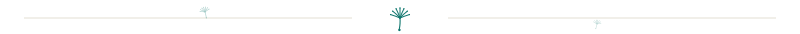
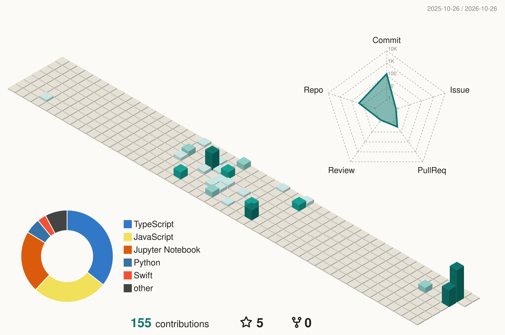

<!-- paper · ink · teal — palette mirrors lazarus-coder.github.io · light #fbfaf7 #201d19 #0e766e · dark #0e1112 #e9e6de #5eead4 -->

<picture>
  <source media="(prefers-color-scheme: dark)" srcset="https://readme-typing-svg.demolab.com?font=JetBrains+Mono&weight=700&size=34&duration=8000&pause=100000&color=E9E6DE&background=00000000&center=true&vCenter=true&width=700&height=64&lines=Ao+Jiang+(Ilya)">
  
</picture>

 

<picture>
  <source media="(prefers-color-scheme: dark)" srcset="https://readme-typing-svg.demolab.com?font=JetBrains+Mono&weight=500&size=18&duration=2600&pause=800&color=5EEAD4&background=00000000&center=true&vCenter=true&width=780&height=44&lines=NLP+%C2%B7+large+language+models+%C2%B7+computational+linguistics;MS+Computational+Linguistics+%40+UW;English+%C3%97+Software+Engineering+%40+SCU;the+unglamorous%2C+load-bearing+parts+of+language+engineering;fitness+%C2%B7+cooking+%C2%B7+long-form+writing+%C2%B7+small+personal+systems">
  
</picture>

  

&nbsp;

<picture>
  <source media="(prefers-color-scheme: dark)" srcset="assets/divider-dark.svg">
  
</picture>

### <samp>$ whoami</samp>

I studied language from both sides — English and software engineering at Sichuan University, then computational linguistics at the University of Washington. My interests live where the two meet: **NLP, large language models, and the unglamorous, load-bearing parts of language engineering**.

Born in Xinjiang, raised on a diet of wind, dust, and existential questions. Offline: fitness, cooking, long-form writing, and small personal systems that make a chaotic life feel a little more ordered.

Notes, experiments, and essays that don't fit anywhere else drift to rest at **[lazarus-coder.github.io](https://lazarus-coder.github.io)**.

<picture>
  <source media="(prefers-color-scheme: dark)" srcset="assets/divider-dark.svg">
  
</picture>

### <samp>$ cat ~/.toolchain</samp>

 

<picture>
  <source media="(prefers-color-scheme: dark)" srcset="assets/divider-dark.svg">
  
</picture>

### <samp>$ ls ~/selected-work/</samp>

| repo | what it is | built with |
| :--- | :--- | :--- |
| [margin-reader](https://github.com/Lazarus-coder/margin-reader) | A discreet, offline desktop reader for Chinese TXT novels — compact workspace, quick covers, bookmarks, saved progress. | TypeScript · Electron |
| [rsi-loop](https://github.com/Lazarus-coder/rsi-loop) | A recursive self-improvement meta-skill for agent workflows — propose → evaluate → keep/revert, with frozen evaluators and anti-cheat checks. | Node.js · LLM |
| [echo-assistant](https://github.com/Lazarus-coder/echo-assistant) | A private assistant that runs on my own Mac — layered memory, explainable forgetting, proactive service, LAN-available. | Node.js · local-first |
| [night-survivors-ts](https://github.com/Lazarus-coder/night-survivors-ts) | A Vampire-Survivors-like roguelite on a hand-built TypeScript engine, with a headless balance simulator. | TypeScript · Canvas |
| [bazi-ziwei-deep-report](https://github.com/Lazarus-coder/bazi-ziwei-deep-report) | A Chinese-metaphysics report engine — dual charting engines, true-solar-time correction, cross-validation → 22–30 page A4 PDF. | Node.js · Agent Skill |
| [zhongze-prototype](https://github.com/Lazarus-coder/zhongze-prototype) | An anonymous group-decision social prototype — weighted voting, opinion clustering, k-anonymous slices. | Node.js |

<picture>
  <source media="(prefers-color-scheme: dark)" srcset="assets/divider-dark.svg">
  
</picture>

### <samp>$ stats --user=Lazarus-coder</samp>

<picture>
  <source media="(prefers-color-scheme: dark)" srcset="https://github-readme-stats.vercel.app/api?username=Lazarus-coder&show_icons=true&include_all_commits=true&rank_icon=github&number_format=short&bg_color=0E1112&title_color=5EEAD4&text_color=E9E6DE&icon_color=5EEAD4&border_color=242A2C&ring_color=5EEAD4">
  
</picture>
<picture>
  <source media="(prefers-color-scheme: dark)" srcset="https://github-readme-stats.vercel.app/api/top-langs/?username=Lazarus-coder&layout=compact&langs_count=8&size_weight=0.5&count_weight=0.5&bg_color=0E1112&title_color=5EEAD4&text_color=E9E6DE&border_color=242A2C">
  
</picture>

<picture>
  <source media="(prefers-color-scheme: dark)" srcset="https://streak-stats.demolab.com?user=Lazarus-coder&background=0E1112&border=242A2C&stroke=242A2C&ring=5EEAD4&fire=5EEAD4&currStreakNum=E9E6DE&currStreakLabel=5EEAD4&sideNums=E9E6DE&sideLabels=A9A49A&dates=6F6A61&hide_border=true">
  
</picture>

<picture>
  <source media="(prefers-color-scheme: dark)" srcset="https://raw.githubusercontent.com/Lazarus-coder/Lazarus-coder/output/snake-dark.svg">
  
</picture>

<picture>
  <source media="(prefers-color-scheme: dark)" srcset="assets/divider-dark.svg">
  
</picture>

  

<a href="https://lazarus-coder.github.io"><samp>move your cursor — the wind follows ↗</samp></a>

